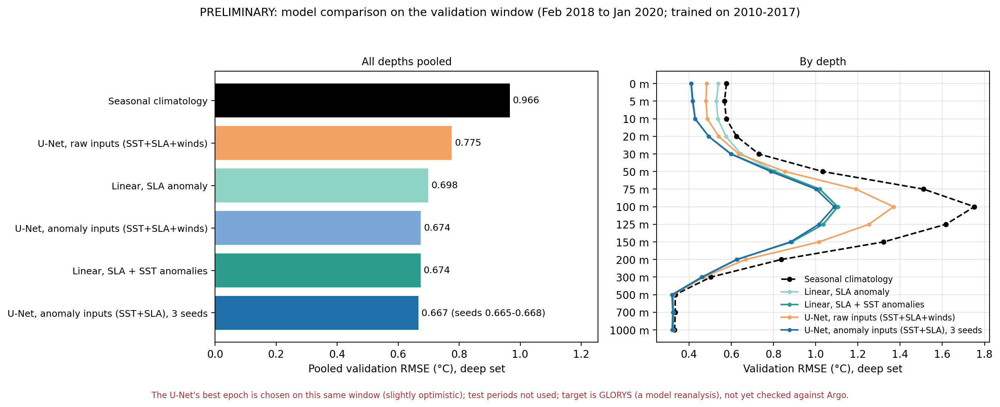

# OceanEmbed: subsurface ocean temperature from satellite surface fields

**Status: work in progress.** No paper has been submitted. All results below are preliminary and use the
validation window only; the two test periods have not been opened.

## What this is
Daily temperature at 15 depths (0, 5, 10, 20, 30, 50, 75, 100, 125, 150, 200, 300, 500, 700, 1000 m) over the
North Indian Ocean (45-105E, 5-30N) on a 0.25 degree grid (101 x 241 = 24,341 cells), estimated from satellite
surface fields (sea level anomaly, sea surface temperature, winds). The target is the GLORYS12V1 ocean reanalysis,
which is a model product and not an observation. Independent validation against Argo is planned and not done yet.

## Preliminary results (validation window 2018-02 to 2020-01, deep-water cells, RMSE in C)

| Model | Pooled RMSE | at 100 m |
|---|---|---|
| Seasonal climatology (training years) | 0.966 | 1.752 |
| Linear regression on SLA anomaly | 0.698 | 1.108 |
| Linear regression on SLA + SST anomalies | 0.674 | 1.104 |
| U-Net, raw inputs (SST, SLA, winds) | 0.775 | 1.369 |
| U-Net, anomaly inputs (SST, SLA), mean of 3 seeds | 0.667 (seeds 0.665-0.668) | 1.086 (seed 0) |

* Sea level carries most of the skill. A two-input linear regression is almost as good as the small U-Net
  (about 1 percent difference), and winds add nothing measurable in this setup.
* Feeding the network raw fields (with their seasonal cycles) made it worse than a linear model; anomaly inputs fixed this.
* The U-Net's best epoch is chosen on the validation window, so its numbers are slightly optimistic.

## Data (all from the Copernicus Marine Service)
| Role | Product | Version | Native resolution |
|---|---|---|---|
| Target | GLORYS12V1, cmems_mod_glo_phy_my_0.083deg_P1D-m (potential temperature) | 202311 | 1/12 deg, 36 levels |
| Input | Sea level anomaly, cmems_obs-sl_glo_phy-ssh_my_allsat-l4-duacs-0.125deg_P1D (sla) | 202411 | 0.125 deg |
| Input | SST, OSTIA reprocessed, METOFFICE-GLO-SST-L4-REP-OBS-SST (analysed_sst) | 202003 | 0.05 deg |
| Input | Winds, cmems_obs-wind_glo_phy_my_l4_0.125deg_PT1H (hourly, averaged to daily) | 202211 | 0.125 deg |

Regridding rules: GLORYS uses every 3rd native cell (exactly on the 0.25 degree grid); the 0.125 and 0.05 degree
fields use exact area means; depths use linear interpolation between the two bracketing native levels and are
missing where either level is missing. 5,810 target days (2010-02-04 to 2025-12-31); inputs start 2010-02-01
(5,813 days) and are paired with targets by calendar date. 12,038 ocean cells at the surface; 9,140 "deep set"
cells have data at all 15 depths (headline metrics use these); 2,898 shelf cells are reported separately.
From July 2021 GLORYS is in its interim production stream.

## Evaluation protocol (configs/splits.yaml, fixed before modelling)
| Part | Dates |
|---|---|
| Train | 2010-02-04 to 2017-12-31 |
| Validation | 2018-02-01 to 2020-01-31 |
| Test A (latest delayed-time reanalysis) | 2020-03-02 to 2021-06-27 |
| Test B (interim production, reported separately) | 2021-08-01 to end of 2025 |

Gaps of at least 30 days between parts. Normalisation, climatology, harmonic fits and regressions use training
years only. The data module raises an error if a test period is requested; each test set is to be opened once.

## Repository layout
    configs/        splits.yaml (frozen evaluation windows)
    src/oceanembed/ grid and depth handling, download pipelines, assembly, dataset.py (date-aligned, test periods
                    unreachable), dataset_anom.py (anomaly inputs)
    scripts/        run_* (download pipelines), check_* (data checks), climatology_baseline.py,
                    baseline_sla_regression.py, baseline_sla_sst_regression.py, train_variant.py,
                    train_variant_anom.py, make_fig_*.py
    results/        CSV results and figures (results/figures)
    data/           raw, interim and processed arrays (not in Git)

## Reproducing
    conda env create -f environment.yml
    conda activate oceanembed-research
    pip install -e .

The download pipelines are monthly, resumable and delete raw files after processing (see the docstrings of
scripts/run_glorys.py, run_surface.py, run_wind.py, run_sst.py). Copernicus Marine credentials are needed and
must be kept outside the repository. After the data are assembled:

    python scripts/check_dataset.py                       # date alignment; reproduces the climatology baseline
    python scripts/climatology_baseline.py
    python scripts/baseline_sla_regression.py
    python scripts/baseline_sla_sst_regression.py
    python scripts/train_variant_anom.py anom_sst_sla sst,sla
    SEED=1 python scripts/train_variant_anom.py anom_sst_sla_s1 sst,sla
    python scripts/make_fig_final_comparison.py

## Limitations
* The target is a model reanalysis that itself assimilates SST, sea level and Argo; near-surface skill is partly built in.
* No independent validation yet (Argo planned). Test periods have not been opened.
* Single-day inputs; one validation window of two years; U-Net epoch selection uses that window.
* Not a real-time system and not a demo of live output.

## Contact
Kanishka Narang, B.Tech CSE (AI/ML), Maharaja Agrasen Institute of Technology, New Delhi.
A paper is in preparation (not yet submitted).

Data: Copernicus Marine Service products listed above; GLORYS12V1 DOI 10.48670/moi-00021.
